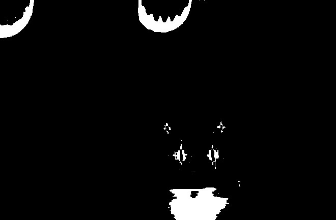
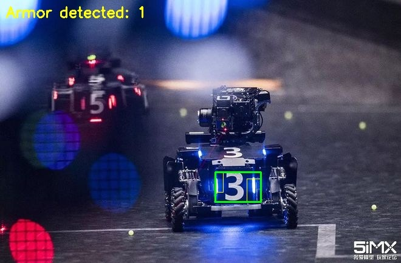

# OpenCV 进阶课后任务：蓝色装甲板灯条识别与配对

## 实现了什么 / 用了什么写法

| 实现了什么         | 用了什么写法                                                                                             |
| ------------------ | -------------------------------------------------------------------------------------------------------- |
| 提取蓝色灯条       | `cvtColor` 转 HSV，`inRange(90,100,200)~(130,255,255)` 生成掩膜                                          |
| 把断开的灯条连起来 | 灯条中间是白的（饱和度为 0），会被抠出洞，用 `morphologyEx` 闭运算补                                     |
| 找轮廓             | `findContours(mask, contours, RETR_EXTERNAL, CHAIN_APPROX_SIMPLE)`                                       |
| 取位置和大小       | `boundingRect` 拿外接矩形，再算中心和宽高                                                                |
| 过滤噪声           | 面积小于 50 的丢掉；高宽比小于 1.8 的丢掉（灯条是竖着的细长条）                                          |
| 保存灯条信息       | 结构体 `LightBar`：矩形、中心、宽、高、面积                                                              |
| 合并同一根灯条     | `mergeBars()`：中心太近的两块合成一个框（反光会把它断成两截）                                            |
| 配对               | `pairBars()` 四条条件：不是同一根、高度比 < 1.35、中心高度差 < 半个灯条高、水平距离在 1.5~6 倍灯条宽之间 |
| 保存配对结果       | 结构体 `Armor`：包围两根灯条的矩形 + 左右灯条下标                                                        |
| 画图               | 黄框画灯条，绿框画装甲板，左上角 `putText` 写数量                                                        |
| 保存中间结果       | 掩膜和结果图都存到 `output/`                                                                             |

## 怎么运行

```bash
cd opencv_armor
cmake -B build -S .
cmake --build build -j

./build/armor                 # 弹窗口
./build/armor --no-window      # 只存图
./build/armor 别的蓝车图.jpg    # 换图
```

## 输出

```
读图：assets/armor.png  660x433
找到灯条 2 根
  灯条0 中心(361, 300) 宽14 高34
  灯条1 中心(418, 313.5) 宽24 高39
配对成功 1 块装甲板
已保存 output/armor_mask.jpg 和 output/armor_result.jpg
```

效果：绿色框住装甲板的数字区域，左上角 `Armor detected: 1`。

## 效果

**① 蓝色区域二值化（掩膜）**



**② 灯条 + 装甲板识别结果**



黄色框是灯条，绿色框是配对出来的装甲板。

## 踩坑

1. **OpenCV 的 H 是 0~180 不是 0~360**，蓝色大概在 90~130。
2. **这张图整辆车都是蓝的**，只卡 H 和 S 会连车身一起框进来，
   所以 V 下限要拉到 200，只留发光的部分。
3. **灯条中间的白芯会被抠掉**，不补闭运算的话一根灯条会变成两个碎片，
   配对时就对不上了。

换别的图时，`kLowerBlue` / `kUpperBlue` 这两个常量一定要按实际情况重调，
这个没有通用值。
