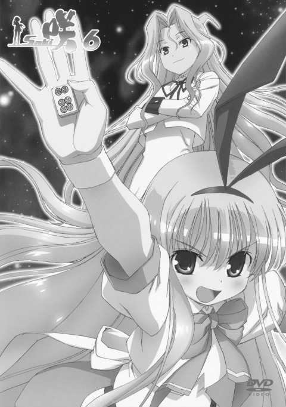
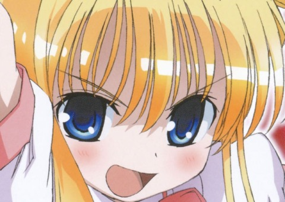

# OpenCV 基础课后任务：图片处理小工具

## 实现了什么 / 用了什么写法

| 实现了什么         | 用了什么写法                                                |
| ------------------ | ----------------------------------------------------------- |
| 读图并判断是否成功 | `cv::imread` + `img.empty()`，失败打印提示后 `return 1`     |
| 输出图片信息       | `img.cols` / `img.rows` / `img.channels()`                  |
| 转灰度             | `cv::cvtColor(img, gray, cv::COLOR_BGR2GRAY)`               |
| 指定 ROI 位置      | 自己算了 `cv::Rect(x, y, w, h)`：从画面中心开始，取右下半块 |
| 防止裁剪越界       | `clampRoi()` 把矩形和图像边界取交集，宽高为负时归零         |
| 只裁一块独立的图   | `img(roi).clone()`，不 clone 就是引用，后面改它会动原图     |
| 在原图上标出 ROI   | 先在 `img.clone()` 的副本上 `cv::rectangle` + `cv::putText` |
| 显示和等待         | `cv::imshow` 三个窗口 + `cv::waitKey(0)`                    |
| 保存并检查         | `cv::imwrite` 返回 bool，三张图逐个判断                     |
| 自动建输出目录     | `std::filesystem::create_directories("output")`             |
| 不开窗口也能跑     | 读 `argv` 里的 `--no-window` 参数跳过 imshow                |

## 怎么运行

```bash
cd opencv_image_tool
cmake -B build -S .
cmake --build build -j

./build/image_tool                 # 弹窗口
./build/image_tool --no-window      # 只存图
./build/image_tool 别的图.jpg        # 换图
```

## 输出

```
读图成功：assets/sample.jpg
    宽 1280，高 1821，通道数 3
已转灰度，通道数 1
ROI: x=640 y=910 w=640 h=455
保存成功
```

`output/` 里会生成 `gray.jpg`、`roi.jpg`、`roi_marked.jpg`。

## 效果

ROI 是 **Region of Interest**，感兴趣的区域。

这张图我特地调了位置，让它正好截到角色的脸 —— 算是字面意义上的"感兴趣"：
程序框出来的，刚好是我感兴趣的那块。

**① 原图 + ROI 红框**


**② 灰度图**



**③ 裁出来的 ROI（感兴趣的部分）**



## 踩坑

`imread` 的路径是**相对运行目录**的。在 `build/` 里执行 `./image_tool` 会读不到
`assets/sample.jpg`，所以要么在项目根目录跑，要么传绝对路径。
